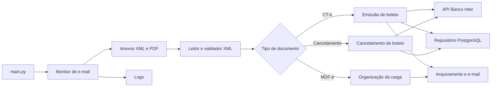

# Bill Gen

Automação para processar documentos fiscais de transporte recebidos por e-mail. O Bill Gen lê XMLs de CT-e e MDF-e, emite e organiza boletos e trata eventos de cancelamento de CT-e.

O programa roda como um serviço em segundo plano: acompanha a caixa de entrada, executa o fluxo adequado para cada documento e registra o resultado em arquivos, no PostgreSQL e nos serviços integrados.

## Funcionalidades

- Monitora e-mails não lidos com CT-e, MDF-e e eventos de cancelamento.
- Extrai e valida dados fiscais dos XMLs.
- Emite boletos do Banco Inter com os dados do CT-e, salva o PDF e o envia por e-mail.
- Armazena no PostgreSQL os dados necessários para localizar e cancelar um boleto.
- Valida eventos de cancelamento autorizados e solicita o cancelamento do boleto correspondente.
- Organiza XMLs, PDFs e boletos por chave fiscal e relaciona CT-es às cargas descritas nos MDF-es.
- Reúne os PDFs relacionados a uma carga e envia o arquivo compilado quando os documentos necessários chegam.
- Mantém logs da execução para acompanhamento e diagnóstico.

## Arquitetura

A aplicação é organizada em módulos com responsabilidades específicas. `main.py` é o ponto de entrada; ele configura os logs e inicia o monitoramento. A partir daí, o módulo de e-mail coordena o fluxo e encaminha cada anexo para o leitor de XML, a integração bancária ou o repositório de dados conforme necessário.



### Responsabilidades dos módulos

| Módulo | Responsabilidade |
| --- | --- |
| `main.py` | Inicializa os logs e inicia o monitoramento contínuo. |
| `src/email_monitor.py` | Consulta e-mails via IMAP, salva anexos temporários e coordena os fluxos de CT-e, MDF-e e cancelamento. Também organiza os documentos e envia PDFs por e-mail. |
| `src/xml_reader.py` | Lê e valida XMLs fiscais e transforma os dados relevantes em estruturas usadas pelo restante da aplicação. |
| `src/bank_API.py` | Autentica na API do Banco Inter e cria, consulta e cancela boletos. |
| `data/db_bill.py` | Implementa o acesso ao PostgreSQL para salvar, consultar e remover registros de boletos expirados. |
| `src/config.py` | Determina o diretório-base da aplicação e carrega configurações do ambiente. |
| `src/utils/logging_bootstrap.py` | Configura o registro da execução em arquivos de log. |

### Fluxo de processamento

1. O programa busca, a cada 15 segundos, e-mails não lidos que correspondam aos filtros configurados.
2. Os anexos XML e PDF são salvos em uma pasta temporária. O XML é interpretado e validado conforme seu tipo.
3. Para um CT-e válido, os dados do destinatário e do serviço são enviados à API do Banco Inter para emissão do boleto. O código de solicitação é guardado no PostgreSQL; o PDF do boleto é arquivado e enviado por e-mail.
4. Para um MDF-e, o sistema identifica os CT-es relacionados e mantém os documentos organizados por carga. Quando os arquivos necessários estão disponíveis, compila os PDFs e envia o resultado.
5. Para um evento de cancelamento, o sistema verifica se o evento foi autorizado, localiza o boleto pelo CT-e e solicita seu cancelamento ao Banco Inter.

## Estrutura do projeto

```text
.
├── data/
│   └── db_bill.py
├── src/
│   ├── utils/
│   │   └── logging_bootstrap.py
│   ├── bank_API.py
│   ├── config.py
│   ├── email_monitor.py
│   └── xml_reader.py
├── main.py
├── requirements.txt
└── README.md
```

## Tecnologias

- Python 3.11+
- IMAP e SMTP do Gmail
- API de cobrança do Banco Inter e certificado digital
- PostgreSQL com `psycopg2`
- `requests`, `python-dotenv`, `pypdf` e biblioteca padrão de XML do Python

## Requisitos

- Python 3.11 ou superior.
- PostgreSQL acessível pela máquina que executa o programa.
- Conta de e-mail com IMAP e SMTP habilitados.
- Credenciais e certificado digital válidos para a API do Banco Inter.

## Instalação

No PowerShell, na pasta do projeto:

```powershell
python -m venv .venv
.\.venv\Scripts\Activate.ps1
pip install -r requirements.txt
```

## Configuração

Crie um arquivo `.env` na raiz do projeto:

```env
EMAIL_USER=seu-email
EMAIL_PASS=sua-senha-ou-senha-de-app

CLIENT_ID=seu-client-id
CLIENT_SECRET=seu-client-secret
ACCOUNT_ID=sua-conta-corrente

DB_USER=usuario-postgresql
DB_PASS=senha-postgresql
```

Coloque o certificado e a chave privada do Banco Inter nos caminhos esperados pelo código:

```text
credentials/Inter API_Certificado.crt
credentials/Inter API_Chave.key
```

O banco utilizado é `bill_gen`, no host `192.168.3.8` e na porta `5432`, definidos atualmente em `data/db_bill.py`. Se o seu PostgreSQL estiver em outro endereço, ajuste esses valores no código. A tabela `boletos` é criada pelo repositório durante a inicialização.

Os filtros de remetente/assunto e o endereço de destino dos e-mails enviados também estão definidos no código (`src/email_monitor.py`). Ajuste-os para o ambiente em que a aplicação será executada.

## Execução

```powershell
python main.py
```

O processo permanece ativo monitorando a caixa de entrada. Para encerrá-lo, use `Ctrl+C`.

Os documentos processados são arquivados em `data/documentos/`, organizados por chave fiscal. Os anexos intermediários ficam em `data/temp_XML Files/`, e os logs são gravados em `bill_gen/logs/`.

## Segurança

XMLs e PDFs fiscais podem conter dados pessoais e comerciais. Não publique o arquivo `.env`, certificados, chaves privadas, documentos reais ou logs. O `.gitignore` do projeto inclui regras para ignorar esses arquivos; revise-as antes de publicar o repositório.
